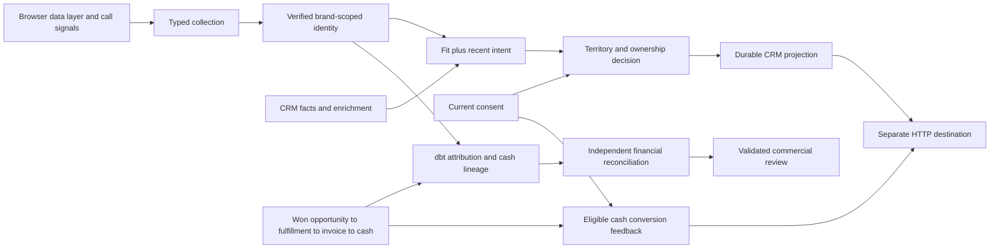

# Customer Signal & Activation

**Which customer signals deserve a sales handoff—and can we trace the resulting commercial outcome back to collected cash?**

A multi-brand B2B organization can capture the right campaign signal, associate it with the wrong account, rely on stale enrichment, route it to the wrong owner, or declare success at Closed Won without proving the resulting economic outcome. This executable system connects customer signals to verified identity, explainable fit and intent, ownership-safe CRM activation, commercial fulfillment, invoices and payment allocations—then returns eligible cash outcomes to measurement.

The browser, API, durable workflow, separate HTTP destination and dbt models all execute locally. [See the generated commercial review](docs/evidence/report.md) and [individual decisions and lineage](docs/evidence/demo.json).

The **seller workbench** turns account inquiries and call evidence into a live LLM brief, a relevant response draft and an explicitly reviewed CRM task. It keeps source citations, current permission, account ownership and delivery receipts inspectable. All businesses and source documents are synthetic; model inference and local HTTP effects are real.


[Run the workbench](docs/seller-workbench.md) · [Inspect the model comparison](docs/evidence/seller/report.md) · [Read the preserved first evaluation](docs/evidence/seller/first-pass-report.md)

<!-- seller-result:start -->
The live regression comparison uses **60 distinct synthetic scenarios and two seeds**. The grounded workflow passes **120/120 proposal-quality checks**, compared with 81/120 for the simple LLM and 60/120 for the governed template. Grounded inference has a measured median of 3.76 seconds and p95 of 4.76 seconds on the recorded workstation, with 0 critical rubric failures. The first failed evaluation is retained. These are finite regression results, not independently validated seller usefulness or commercial uplift.
<!-- seller-result:end -->

<!-- executed-result:start -->
The executed synthetic demonstration has **120 accounts and 1,070 source events**. It produces **$55,300.00 allocated cash**, 80 reconciled CRM projections and 40 eligible cash-conversion records. Decisions include 10 qualified, 20 nurture, 30 customer and 60 hold outcomes. Open qualified opportunities do not manufacture cash; exclusions remain inspectable.
<!-- executed-result:end -->



**Signals are not identities. A score is not a sale. An invoice is not cash.** The system keeps these distinctions visible instead of filling missing links with plausible defaults.

## What the implementation proves

| Commercial problem | Executed behavior |
|---|---|
| Campaign identifiers disappear after navigation | Consent-aware JavaScript keeps campaign context within a brand-scoped browser session and emits a closed data-layer contract |
| A browser visitor is mistaken for an account | Only a separately authenticated CRM association links a session; no fuzzy email, phone or domain merge |
| Enrichment disagrees with CRM or another provider | CRM facts retain authority; fresh provider evidence supplies missing fit, with material disagreement held for review |
| Repeated page views inflate intent | Distinct qualifying behaviors contribute once within a seven-day window; fit and intent remain separate |
| A qualified lead is routed to the wrong brand or rep | Brand/territory rules preserve valid ownership and block mismatches |
| A downstream write succeeds but the response is lost | A stable request key is reconciled before retry; an actual worker-death test proves recovery |
| Attribution doubles invoices across payments | dbt preserves payment-allocation grain and aggregates invoice values separately; a Python traversal checks every lineage row |
| Cash feedback lacks an eligible click or permission | The allocation remains in financial reporting with a named conversion exclusion |

The local CRM and conversion interfaces exercise real HTTP and persisted effects. Vendor integrations and cloud warehouse execution are outside this implementation; see the [operating boundaries](docs/limitations.md).

## Inspect a real browser interaction


The browser test drives these controls, then supplies an independently authenticated CRM association, delivers the resulting CRM projection, loads won/fulfillment/invoice/payment events, executes dbt and verifies four eligible cash conversion records in the remote destination. [Validation and failure matrix](docs/validation.md).

## Review a seller action

The workbench assembles account-scoped documents and verified commercial state. Qwen3-14B interprets the customer's need, selects source-bound quotation spans and proposes a response. The seller can inspect sources, edit the draft, reject the proposal or approve its exact content. A changed permission or evidence version blocks dispatch; a lost acknowledgement is reconciled before retry.

The **Evaluation evidence** tab lets reviewers compare saved template, simple LLM and grounded-workflow outputs for each scenario, inspect their source documents and see the checks behind each result. It works without a model download or provider credential. The live workspace uses an authenticated model endpoint.

```text
python scripts/seller.py --no-model
```

Open `http://127.0.0.1:8530`, enter the operator token printed by the launcher and choose Evaluation evidence. For fresh inference, follow the [pinned model and application setup](docs/seller-workbench.md).

[Actual application records](docs/evidence/seller/application.json), [operational dbt results](docs/evidence/seller/operations.json) and [runtime provenance](docs/evidence/seller/runtime.json) support the screenshots. Operational metrics count generated proposals and reviewed tasks; they do not establish commercial uplift. The original cash lineage remains independent of the model.

## Run it

Use **Python 3.12** from the repository directory:

```text
python -m venv .venv
```

Activate `.venv\Scripts\Activate.ps1` on Windows, or `source .venv/bin/activate` on macOS/Linux. Then:

```text
python -m pip install -r requirements.lock
python -m pip install --no-deps --no-build-isolation -e .
python -m playwright install chromium
python scripts/demo.py --workspace work/demo
python scripts/verify.py
```

On Linux, Playwright may require `python -m playwright install --with-deps chromium`. Each demo workspace must be new; the command refuses to replace an existing database. Verification chooses its own fresh workspace, runs tests including Chromium and dbt, repeats the full demonstration and compares its results. It generates source-bound evidence and a package manifest.

To open the browser intake independently, run `python scripts/serve.py --workspace work/intake` and visit the printed loopback URL with optional `utm_source`, `utm_medium`, `utm_campaign` and `gclid` parameters. No enterprise credentials are exposed to JavaScript. The page intentionally records intent without collecting personal contact details; a verified CRM association is a separate server-side event. [API contracts and operating commands](docs/operations.md).

## Review the engineering

- [Architecture, grains and business policy](docs/architecture.md)
- [Operations and recovery](docs/operations.md)
- [Scenario-to-test matrix and hostile review](docs/validation.md)
- [Local execution record](docs/evidence/verification.json)
- [Repository map](docs/repository-map.md)
- [Limitations and vendor boundaries](docs/limitations.md)

The bounded local system uses SQLite transactions for durable admission and delivery, FastAPI for source boundaries, and DuckDB/dbt for the analytical graph. A broker, Airflow, LLM or second warehouse would add deployment work without improving this proof. The full test suite is also defined in GitHub Actions; a workflow definition is not evidence of a hosted run.

## Scope

First observed campaign touch is descriptive attribution, not causal lift or a propensity model. Cash means positive payment allocations against completed fulfillments and won opportunities; refunds, credits, FX, partial fulfillment completion and revenue recognition are outside this version. The conversion window is an explicit synthetic 90-day policy, not an assertion about every ad platform. The local execution lane is serialized and is not a distributed throughput benchmark. [Full claim boundary](docs/limitations.md).

Source contract v2 names the commercial action `contact_sales` and the downstream object `fulfillment`. Use fresh workspaces for this release; earlier contract data is rejected rather than silently reinterpreted. [Contract and upgrade boundary](docs/operations.md).
