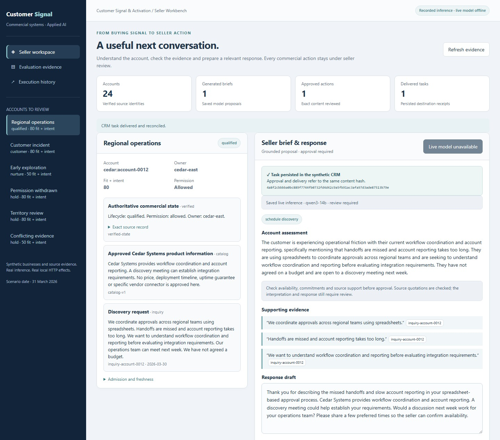
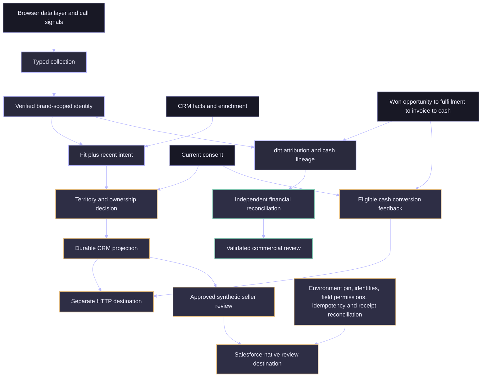
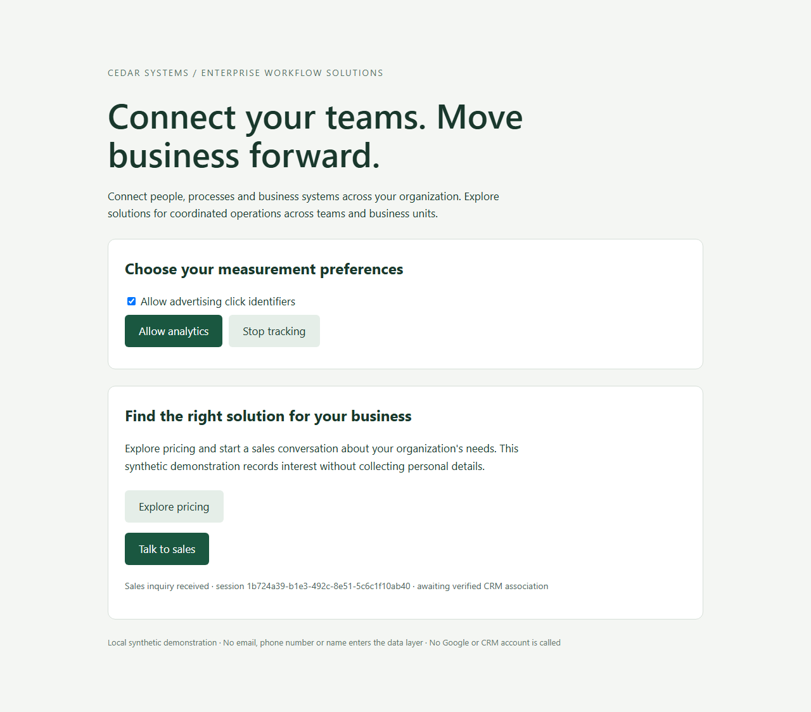

# Customer Signal & Activation

**From customer signals to a verified CRM action and collected cash.**

An accurate campaign signal can still lead to the wrong account, stale enrichment or an unsafe sales handoff. This system resolves identity, scores fit and intent, preserves CRM ownership and traces activity through fulfillment, invoices and payment allocations. Eligible collected-cash outcomes return to measurement without treating Closed Won as collected revenue.

**Engineering proof:** Brand-scoped identity and source authority, durable activation and receipt recovery, restricted Salesforce review writes, and payment-allocation reconciliation. Browser, model evaluation and local workflow tests are published alongside native Salesforce and Snowflake execution records. The vendor acceptance history includes both failed stages and successful continuations.

The browser, API, durable workflow, separate HTTP destination and dbt models all execute locally. [See the generated commercial review](docs/evidence/report.md) and [individual decisions and lineage](docs/evidence/demo.json).

The **seller workbench** uses account inquiries and call evidence to produce an LLM brief, response draft and reviewable CRM task. Source citations, ownership, permission and delivery receipts remain inspectable. Businesses and source documents are synthetic; model inference and local HTTP effects execute. The public code illustrates identity, enrichment, controlled CRM state and revenue lineage without exposing client data.



Captured from the local UI using a preserved Qwen3-14B output and reviewer edit. The screenshot records the approved action and receipt; it does not represent a fresh inference run. [Capture provenance](docs/images/ui-refresh.json).

[Run the workbench](docs/seller-workbench.md) · [Inspect the model comparison](docs/evidence/seller/report.md) · [Read the preserved first evaluation](docs/evidence/seller/first-pass-report.md)

## From account evidence to an owned action

At LMN, I connected acquisition reporting to Salesforce pipeline and lifecycle analysis across multiple SaaS products. Through Groundbreakers, I designed and delivered customer-system integrations with canonical identifiers, persistent source mappings, preserved ownership and governed lifecycle state. The recurring challenge was deciding which account a signal belonged to, which source could change its state and whether a seller action was still appropriate.

This implementation makes those decisions inspectable. Brand-scoped identity, separate fit and intent, approval-bound CRM actions, durable receipts and payment-allocation lineage connect a signal to an accountable commercial process. The native Salesforce–Snowflake round trip verifies an internal review, lost-acknowledgement recovery and independent readback. It does not send customer communications. These controls apply wherever enrichment, CRM and financial systems must cooperate without confusing a recommendation, a sale and collected cash.

[Connected execution](docs/evidence/connected-integration/README.md) · [Authority and grain](docs/architecture.md)

### Verification boundaries

| Evidence | What has executed |
|---|---|
| Local business workflow | Browser, HTTP destinations, recovery and independently reconciled dbt cash lineage |
| Recorded LLM evaluation | Real Qwen3-14B inference on the published synthetic regression suite; independent usefulness review remains pending |
| Native Salesforce preflight | Passed against an explicitly pinned Developer Edition org with separate identities; authenticated environment, schema and effective permissions verified |
| Native Salesforce delivery/security matrix | **Completed across recorded stages.** One fresh synthetic review; lost-acknowledgement recovery, duplicate/mapping rejection, restricted mutations and exact read-back. A 35-request attempt and 34-request continuation supply the passing experiments; intermediate failures remain visible |
| Connected Salesforce ↔ Snowflake | **Executed across recorded stages:** actual synthetic CRM state → Snowflake SQL decision → one immutable Salesforce review → independent exact read-back → warehouse feedback holds further activation. Failed attempts and final cleanup observation are retained |

[Native evidence and investigation](docs/evidence/salesforce-native/README.md) · [Correction and execution history](docs/salesforce-finish-review.md). A passing preflight is separate from native delivery acceptance, and a passing local emulator is not vendor execution. Native UI screenshots and a combined fresh-inference-to-Salesforce run are not claimed.

**Connected warehouse proof:** [Native Salesforce ↔ Snowflake round trip](docs/evidence/connected-integration/README.md) with [architecture and reproduction steps](docs/connected-integration.md). Snowflake produces a deterministic internal recommendation, current Salesforce authority is checked before dispatch, and the observed CRM effect feeds the next warehouse decision. The warehouse cannot authorize customer contact.

[Integration branch CI](https://github.com/rlbsem/customer-signal-activation/actions?query=branch%3Afeat%2Fsalesforce-snowflake-roundtrip) · [Recorded local verification](docs/evidence/connected-integration/local/verification.json).

<!-- seller-result:start -->
The live regression comparison uses **60 distinct synthetic scenarios and two seeds**. The grounded workflow passes **120/120 proposal-quality checks**, compared with 81/120 for the simple LLM and 60/120 for the governed template. Grounded inference has a measured median of 3.76 seconds and p95 of 4.76 seconds on the recorded workstation, with 0 critical rubric failures. The first failed evaluation is retained. These are finite regression results, not independently validated seller usefulness or commercial uplift.
<!-- seller-result:end -->

<!-- executed-result:start -->
The executed synthetic demonstration has **120 accounts and 1,070 source events**. It produces **$55,300.00 allocated cash**, 80 reconciled CRM projections and 40 eligible cash-conversion records. Decisions include 10 qualified, 20 nurture, 30 customer and 60 hold outcomes. Open qualified opportunities do not manufacture cash; exclusions remain inspectable.
<!-- executed-result:end -->

## Engineering decisions tested against real failures

- **A Salesforce error was not sufficient proof of permission enforcement.** The reviewer-create probe returned `CANNOT_INSERT_UPDATE_ACTIVATE_ENTITY`, with no confirmed vendor cause. The permission verdict instead uses checked CRUD/FLS and before-and-after evidence that no unauthorized record appeared. [Acceptance investigation](docs/salesforce-finish-review.md).
- **Read-only Salesforce requests can change observation timestamps.** Successive GETs advanced `LastViewedDate` and `LastReferencedDate`, initially failing the comparison. The corrected SOQL check compares business and modification-audit fields. Earlier failures remain in the staged acceptance record. [Native evidence](docs/evidence/salesforce-native/README.md).
- **A passing model rubric did not establish source support.** The grounded workflow scored 120/120 on defined regression checks, yet an independent review found unsupported claims about support availability and escalation. The seller must verify, edit or reject those claims before approval. [Source-support review](docs/seller-review-notes.md).



**Signals are not identities. A score is not a sale. An invoice is not cash.** The system keeps these distinctions visible instead of filling missing links with plausible defaults.

## What the implementation proves

| Commercial problem | Executed behavior |
|---|---|
| Campaign identifiers disappear after navigation | Consent-aware JavaScript keeps campaign context within a brand-scoped browser session and emits a closed data-layer contract |
| A browser visitor is mistaken for an account | Only a separately authenticated CRM association links a session; no fuzzy email, phone or domain merge |
| Enrichment disagrees with CRM or another provider | CRM facts retain authority; fresh provider evidence supplies missing fit, with material disagreement held for review |
| Repeated page views inflate intent | Distinct qualifying behaviors contribute once within a seven-day window; fit and intent remain separate |
| A qualified lead is routed to the wrong brand or rep | Brand/territory rules preserve valid ownership and block mismatches |
| A downstream write succeeds but the response is lost | A stable request key is reconciled before retry; an actual worker-death test proves recovery |
| Attribution doubles invoices across payments | dbt preserves payment-allocation grain and aggregates invoice values separately; a Python traversal checks every lineage row |
| Cash feedback lacks an eligible click or permission | The allocation remains in financial reporting with a named conversion exclusion |

The local CRM and conversion destinations execute real HTTP requests with persisted effects. The isolated Salesforce Developer Edition adapter has native synthetic review delivery and security evidence. The separate [connected Salesforce ↔ Snowflake workflow](docs/evidence/connected-integration/README.md) also executed natively; the commercial cash lineage remains a local DuckDB/dbt workflow. See [operating boundaries](docs/limitations.md) and the [Salesforce acceptance contract](docs/salesforce-acceptance-plan.md).

## Inspect a real browser interaction



The browser test drives these controls, then supplies an independently authenticated CRM association, delivers the resulting CRM projection, loads won/fulfillment/invoice/payment events, executes dbt and verifies four eligible cash conversion records in the remote destination. [Validation and failure matrix](docs/validation.md).

## Review a seller action

The workbench assembles account-scoped documents and verified commercial state. Qwen3-14B interprets the customer's need, selects source-bound quotation spans and proposes an advisory response. The seller inspects those sources, prepares governed CRM content, and approves its exact payload. Operational commitments require separately registered, current authority. A changed permission or evidence version blocks new dispatch; a lost acknowledgement is reconciled before retry. [Execution contract, limits and operator procedure](docs/seller-authority.md).

The **Evaluation evidence** tab lets reviewers compare saved template, simple LLM and grounded-workflow outputs for each scenario, inspect their source documents and see the checks behind each result. It works without a model download or provider credential. The live workspace uses an authenticated model endpoint. Recorded outputs are retained verbatim, including imperfect drafts; see the [focused source-support review and reviewer-edited example](docs/seller-review-notes.md).

```text
python scripts/seller.py --no-model
```

To run the operator interface, first follow the [local workbench setup](docs/seller-workbench.md). Once the server is running, open `http://127.0.0.1:8530` in a browser on the **same computer**, enter the launcher-provided operator token and choose Evaluation evidence. This address is not a public demo. For a no-install review, inspect the [recorded workbench screenshot](docs/images/seller-brief.jpg) and [hosted Engineering Evidence Lab](https://rlbsem.github.io/enterprise-revenue-systems-lab/).

[Actual application records](docs/evidence/seller/application.json), [operational dbt results](docs/evidence/seller/operations.json) and [runtime provenance](docs/evidence/seller/runtime.json) support the screenshots. Operational metrics count generated proposals and reviewed tasks; they do not establish commercial uplift. The original cash lineage remains independent of the model.

Those original screenshots and benchmark records are preserved. The [authority-hardening evidence](docs/evidence/seller-authority/README.md) separately records actual before/after local delivery, six new Qwen3-14B responses and current UI captures. This finite control does not establish general semantic grounding or fresh Salesforce execution.

## Run it

Use **Python 3.12** from the repository directory:

```text
python -m venv .venv
```

Activate `.venv\Scripts\Activate.ps1` on Windows, or `source .venv/bin/activate` on macOS/Linux. Then:

```text
python -m pip install -r requirements.lock
python -m pip install --no-deps --no-build-isolation -e .
python -m playwright install chromium
python scripts/demo.py --workspace work/demo --evidence work/demo-evidence
python scripts/verify_salesforce.py --evidence-dir docs/evidence/salesforce-local/your-run --presentation-refresh docs/images/ui-refresh.json
```

On Linux, Playwright may require `python -m playwright install --with-deps chromium`. Each demo workspace must be new; the command refuses to replace an existing database. The archive-preserving verifier runs tests including Chromium and dbt, repeats the full demonstration and compares its results. It writes separate evidence and regenerates the package manifest. For another run, supply a fresh `--evidence-dir docs/evidence/salesforce-local/your-run`. The original `scripts/verify.py` regenerates older root evidence; use the dedicated verifier for this revision.

To open the browser intake independently, run `python scripts/serve.py --workspace work/intake` and visit the printed loopback URL with optional `utm_source`, `utm_medium`, `utm_campaign` and `gclid` parameters. No enterprise credentials are exposed to JavaScript. The page intentionally records intent without collecting personal contact details; a verified CRM association is a separate server-side event. [API contracts and operating commands](docs/operations.md).

## Review the engineering

- [Architecture, grains and business policy](docs/architecture.md)
- [Operations and recovery](docs/operations.md)
- [Scenario-to-test matrix and hostile review](docs/validation.md)
- [Local execution record](docs/evidence/verification.json)
- [Repository map](docs/repository-map.md)
- [Limitations and vendor boundaries](docs/limitations.md)

The bounded local system uses SQLite transactions for durable admission and delivery, FastAPI for source boundaries, and DuckDB/dbt for the analytical graph. The seller workbench adds optional live LLM interpretation behind evidence, human review and approval controls; the existing deterministic cash lineage remains independent of inference. A broker, Airflow or second warehouse is not needed for this local demonstration. The full test suite runs in GitHub Actions; the published CI run, rather than the workflow definition alone, supplies evidence of hosted verification.

## Scope

First observed campaign touch is descriptive attribution, not causal lift or a propensity model. Cash means positive payment allocations against completed fulfillments and won opportunities; refunds, credits, FX, partial fulfillment completion and revenue recognition are outside this version. The conversion window is an explicit synthetic 90-day policy, not an assertion about every ad platform. The local execution lane is serialized and is not a distributed throughput benchmark. [Full claim boundary](docs/limitations.md).

Source contract v2 names the commercial action `contact_sales` and the downstream object `fulfillment`. Use fresh workspaces for this release; earlier contract data is rejected rather than silently reinterpreted. [Contract and upgrade boundary](docs/operations.md).

## Salesforce review acceptance

A local extension adds pinned sandbox/Developer Edition approval, a synthetic account registry, scoped review-record metadata, durable bounded delivery and an operator review workflow. Metadata is deployed, native preflight has passed and the scoped delivery/security matrix has completed across recorded stages. [Implementation and native acceptance plan](docs/salesforce-acceptance-plan.md) · [Native execution boundaries](docs/evidence/salesforce-native/README.md). The original 23-request failure is retained. The approved correction created one additional review and proved recovery/uniqueness; a guarded continuation completed the remaining restrictions without another POST. The evidence identifies inherited experiments and source versions rather than presenting the history as one uninterrupted pass. No combined fresh-model-to-Salesforce run or commercial outcome is claimed. Prior inference and financial evidence is preserved.
