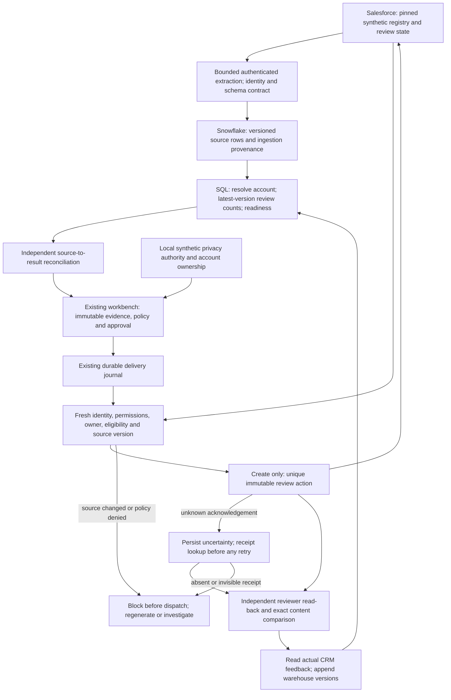

# Governed Salesforce ↔ Snowflake review integration

An account review can become unsafe while it waits in a warehouse: ownership changes, eligibility is withdrawn, another review is opened, or an acknowledgement is lost. This vertical slice computes an internal review recommendation from actual synthetic Salesforce state, then proves the exact approved result returned to Salesforce and fed back into the warehouse.

The destination is the existing immutable `Seller_Action__c` review inbox. It does not send a message, change a standard Account or Opportunity, or confer consent. The SQL recommendation is deterministic; no new model inference is claimed.

## Architecture and authority



| Authority | Owned fields and decisions |
|---|---|
| Salesforce synthetic registry | Approved account key, brand, active/synthetic eligibility and approved owner |
| Salesforce review history | Review identity, immutable approved content, current review status and modification timestamp |
| Existing local synthetic event ledger | Contact permission, commercial policy and local routing; the warehouse cannot grant permission |
| Snowflake | Derived review counts and a proposed internal clarification step |
| Workbench approval | Exact payload authorized under the owner's synthetic demonstration policy; not a human business-review decision |
| Independent Salesforce reader | What actually exists after dispatch; a create acknowledgement alone is insufficient |

Registry `Active__c` is eligibility, not contact consent. The existing commercial fixture and its March 31 scenario clock remain unchanged. Native source freshness uses the actual execution clock and a maximum five-minute prewrite window. This demonstration does not claim a live production privacy feed.

## Implementation

- [Source contract and extraction](../src/signals/integration_source.py): only pinned registry mappings, fixed projected fields and at most 100 records per query; incomplete pagination, unexpected fields, conflicting identity and future versions fail closed. No customer names, notes, email addresses or review free text enter the warehouse.
- [Versioned ingestion](../src/signals/integration_warehouse.py) and [table contract](../src/signals/integration_sql/schema.sql): record identity includes the verified organization and source ID through a digest; timestamps and source authority remain explicit. Ingestion runs and observation time are separate from business versions.
- [Decision SQL](../src/signals/integration_sql/decisions.sql): latest version per source record, one resolved account grain, review counts before joining. An active synthetic account with completed review history and no Pending review proposes `clarify_need`; all other states hold.
- [Bounded Snowflake execution](../src/signals/integration_snowflake.py): existing RSA identities, secondary roles disabled, X-Small/60-second/one-cluster checks, existing shared acceptance lock, maximum 100 statements per lane and 30-second statement timeouts. Only a uniquely owned transient schema is created and dropped. Existing revenue tables and publications are untouched.
- [Activation and independent reconciliation](../src/signals/integration_activation.py): source-to-SQL oracle, the existing document/proposal/approval flow, and the existing Salesforce dispatcher. The additional journal table records the last remote dispatch boundary; it is not another approval engine.
- [Native acceptance runner](../scripts/run_connected_acceptance.py): preflight, source extraction, warehouse execution, prewrite revalidation, one create with controlled loss of its real success response, persisted receipt recovery, independent reader comparison, unique-key count and warehouse feedback.

The same SQL bytes execute on DuckDB and Snowflake. The native result is compared with DuckDB, an independent Python source oracle, and the exact Salesforce read-back. The feedback lane compares appended versions against an independent full snapshot on DuckDB. Existing dbt models are preserved; this small query does not need another dbt project.

## Failure and recovery contract

| Case | Expected behavior |
|---|---|
| Same source delivery or same approved intent repeated | No extra warehouse version or CRM effect |
| Older actual source batch arrives after feedback | Latest-version decision cannot regress |
| Same-version content conflict, ambiguous identity, duplicate physical grain, malformed join | Reject before activation |
| CRM source changes after warehouse processing | Compare the fresh source hash and block the new POST |
| Current owner, consent, eligibility or field permissions change | Existing policy and destination controls reject a new effect |
| Definite API rate-limit rejection | Bounded delayed retry, then explicit exhaustion |
| Timeout, server error or process death around POST | Durable unknown outcome; lookup and compare the exact receipt |
| Unknown outcome plus no visible receipt | Stop for read-only investigation; never blindly replay |
| Already-committed receipt after eligibility/consent withdrawal | Reconcile history without authorizing another write |
| Partial completion or read-back mismatch | Keep failed evidence and durable intent; continue with GET-only clients |

The local tests include a real child-process exit after the local HTTP destination commits. Native acceptance reopens the persisted dispatcher; it does not claim a native process-kill experiment or induced Salesforce rate limiting.

## Reproduce without credentials

Follow the repository's [core setup](../README.md#run-it), then:

```text
python -m pytest -q
python scripts/demo_connected.py --output work/connected-replay.json
python scripts/check_connected_evidence.py
```

The demo replays sanitized, recorded native source snapshots through real local SQL. It performs no vendor calls. The evidence checker verifies recorded results and fingerprints offline; it does not re-execute Snowflake.

## Native operator procedure

Use the existing pinned Developer Edition or approved sandbox and its separate integration/reviewer/read-only administrator CLI identities. Reuse the already registered Snowflake RSA service identities and monitored fixture warehouse. No repeated administrator setup, OAuth change or new permission grants are required for this environment.

Keep configuration, keys, tokens, raw responses and SQLite/DuckDB files outside public files. The Salesforce configuration shape is [documented here](../salesforce/runtime.example.json). The existing Snowflake private JSON supplies `SNOWFLAKE_ACCOUNT`, `SNOWFLAKE_USER`, `SNOWFLAKE_PRIVATE_KEY_PATH`, `SNOWFLAKE_CONSUMER_USER` and `SNOWFLAKE_CONSUMER_PRIVATE_KEY_PATH`. Optional key passphrases remain private. A distinct native Python environment can install [requirements-native.in](../requirements-native.in); `--warehouse-python` selects it.

```text
python scripts/run_connected_acceptance.py --mode extract --salesforce-config <private-json> --workspace .local/extract
python scripts/run_connected_acceptance.py --mode acceptance --salesforce-config <private-json> --snowflake-config <private-json> --warehouse-python <native-python> --workspace .local/acceptance --owner-confirmed-fixture-monitor --execute-approved-synthetic-writes
python scripts/export_connected_evidence.py --workspace .local/acceptance --output docs/evidence/connected-integration/new-record
```

The monitor flag acknowledges previously verified owner setup; it does not inspect or increase a quota. The restricted runtime role may not see the monitor. One credit is the pre-existing monitor quota, not a promised run cost or zero-cost claim. The runner never resizes, raises limits or provisions a warehouse. Query history exposes partial resource counters; it does not establish total billed compute/storage cost.

If execution stops after a committed write, preserve that workspace and use a new report directory:

```text
python scripts/run_connected_acceptance.py --mode finish --resume-from .local/acceptance --salesforce-config <private-json> --snowflake-config <private-json> --warehouse-python <native-python> --workspace .local/continuation --owner-confirmed-fixture-monitor
```

`finish` uses GET-only Salesforce clients and never regenerates or reapproves an action. It verifies compatible business-source fingerprints, preserves the prior failed record, reconciles the saved intent, then finishes source conservation and warehouse feedback. `--mode reconcile` performs only the receipt reconciliation. A fresh acceptance run refuses when existing Pending state makes the account ineligible; do not reset records to manufacture another pass.

If the feedback lane's analytical checks all passed and only immediate suspension confirmation failed, preserve that result and add `--feedback-checkpoint <prior-workspace>/warehouse-after.json` to `finish`. The postflight helper verifies the exact source-batch hashes and recorded decisions, then performs metadata-only confirmation. It neither rebuilds the warehouse nor resumes it. A running warehouse, remaining integration schema or incomplete analytical checkpoint fails this path. Earlier failed reports remain intact.

## Evidence and limits

[Connected native records and execution matrix](evidence/connected-integration/README.md) distinguish native observations, local fault injection, historical Salesforce security acceptance and hosted CI.

This is a bounded architectural demonstration. It is not CDC, production deployment, bulk throughput evidence, automatic customer outreach or an atomic distributed transaction. Salesforce insertion validation enforces mapping/active-owner rules; there remains a race between the final source read and create for historical review status. Stable intent identity and the unique destination key protect repeated execution of the same source state. A production implementation requiring stronger cross-record serialization needs server-side version enforcement or a transactional Salesforce endpoint.

Snowflake standard-table uniqueness is checked explicitly, not assumed from declared constraints. The supported writer is serialized by the existing shared gate. Source deletes/tombstones, arbitrary custom-field changes and multiple independent native workers are outside this acceptance. Prior review completion is operational review state, not proof of a sale or revenue uplift.

