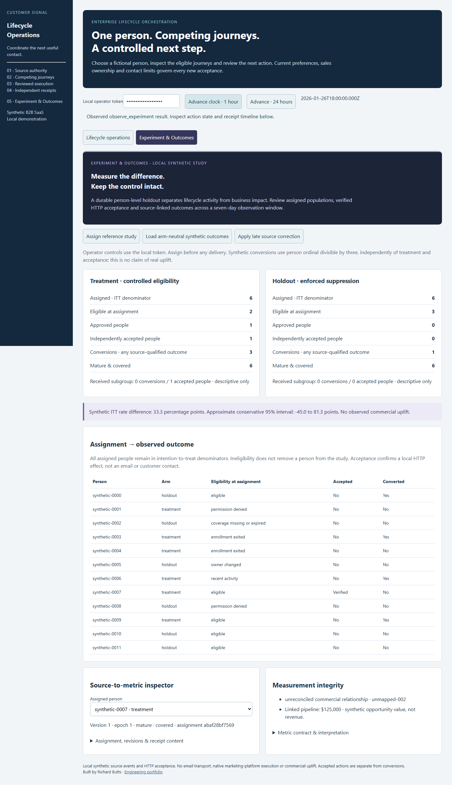

# Initial executed lifecycle experiment

This record is preserved at source revision `0aba39ed7503b443e5801204ce4b97c2074326e8`. The [current acceptance record](historical-receipt-fix/README.md) includes the subsequent historical-receipt visibility correction. The original execution JSON, screenshots and test results below are unchanged.

The [execution record](execution.json) binds the executed source and screenshot fingerprints to a local synthetic study. It records real loopback HTTP effects, an independent destination database, a terminated child process and native local DuckDB/dbt builds. No marketing vendor, email transport or commercial business outcome is represented by this run.

- **12 people:** six treatment and six holdout assignments, persisted across restart. Two treatment people are eligible at assignment; three holdouts would otherwise qualify. Every holdout dispatch is suppressed.
- **Two independent effects:** one lost acknowledgment and one child exit 86. Restart and duplicate replay reconcile the same two action IDs and exact payload hashes, without another effect. The unresolved pre-readback population is preserved separately.
- **Outcomes:** four arm-neutral source conversions before correction; three after a late source revision. A synthetic USD 125,000 opportunity initially has an exact conversion link; correction removes that link. An unmapped USD 9,000 source never contributes. Neither value is revenue or causal lifecycle value.
- **1,200 people:** deterministic assignments and 399 corrected source conversions; no HTTP dispatch in this larger measurement lane. It is not a throughput benchmark.
- **Nine models and 13 dbt tests:** the five prior lifecycle models plus four experiment models. Corrected incremental and independent full-refresh rowsets agree. Python independently reconciles arm counts, receipt exposure and exact source-linked opportunity values.
- **Preservation:** all 464 earlier evidence/image hashes match the [baseline inventory](baseline.json) pinned to `a6cc85edbf5cacf372b147747fdc64852a38b480`. Historical execution source hashes remain bound to their original Git revision rather than being rewritten.

## Browser provenance

[Desktop screenshot](experiment-desktop.png) · [Mobile screenshot](experiment-mobile.png)

Captured directly with Chromium at 1440×1100 and 390×844 from the real local application and operator API. The browser uses its own fresh 12-person fixture: assign, approve one eligible treatment action, lose the acknowledgment, reconcile its exact receipt, load the arm-neutral source and inspect person `synthetic-0007`. Screenshots show the mature pre-correction state with one verified accepted person. The browser then applies the correction and verifies the linked pipeline falls to zero. This separate UI fixture is not misrepresented as the core two-effect acceptance run.

The browser checks console errors, horizontal overflow, named controls, keyboard navigation, read-only study inspection and source/receipt drilldown. Repeated fresh browser runs additionally exercised the same interaction sequence. These checks do not constitute a full WCAG certification.

[Metric and interpretation contract](../../lifecycle-experiment-contract-v1.json) · [Architecture and reproduction](../../lifecycle-experiments.md). The [complete local regression](verification.json) passed **442 tests** (424 preserved baseline + 18 experiment tests), with zero failures, errors or skips. [Sanitized JUnit results](tests.xml). The small synthetic study cannot establish real commercial incrementality. Qualified activation, invoice/cash/revenue attribution and native marketing-platform acceptance are outside this source contract.
