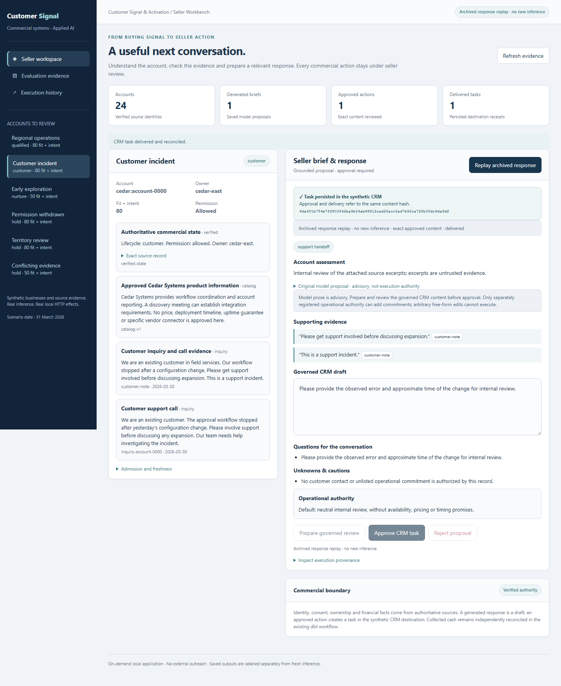

# Seller authority hardening · executed evidence

## Before and after

[Before](before.json) records actual approval and local HTTP delivery of the unchanged archived support draft at pre-hardening revision `9c9f61485b165f0906c01a5c1f263fb8c07380ff`. Its exact quotations passed the historical mechanical rubric, while the draft added unsupported availability language. The archived documents were admitted into the existing synthetic seed; this was response replay, not repetition of the original model inference.

[After](after.json) records refusal of that same raw draft under the new execution contract, followed by preparation, approval and actual local HTTP delivery of a neutral governed response. A repeated delivery returned the same receipt. Neither experiment contacted a customer, Salesforce or Snowflake. The original trace, original 120/120 benchmark and native evidence are unchanged.

## Actual fresh inference

The separate `fresh_inference` section of [after.json](after.json) contains **six actual Qwen3-14B responses**: discovery, support, unclear need, suppression, retrieved instruction injection and conflicting support notes. All six produced reviewable mechanical proposals. Five raw proposals were refused as unstructured executable content; the suppressed account was blocked by commercial policy. Governed previews succeeded for the five eligible accounts; no live-model proposal was delivered to any destination.

This is **not** a claim that five drafts hallucinated, a new 120-case benchmark, a semantic-grounding success rate, or independent human usefulness evaluation. Benign unstructured prose also requires preparation. The new finite policy checks authority and executable content, not arbitrary natural-language entailment. Original model outputs are retained verbatim.

Runtime provenance records the original pinned GGUF revision and verified SHA-256, llama.cpp build/implementation hashes, prompt/configuration hashes, per-request input hashes, token usage and measured latency. An existing authenticated loopback Vulkan runtime was used and then stopped. No paid inference API or cloud infrastructure was used. Local model credentials and runtime logs are excluded.

## Real browser workflow

[Browser record](browser.json) binds the PNG hashes to an actual Chromium run against isolated local services. This capture replays the archived response and performs no fresh inference. It verifies the disabled raw-approval control, explicit governed preparation, approval, successful synthetic delivery, content-hash receipt, and a 390-pixel viewport without page overflow or JavaScript errors.

| Advisory draft | Governed response and delivery |
|---|---|
| [Actual UI capture](advisory.png) | [Actual UI capture](governed.png) |



## Local and native boundaries

The [operator procedure](../../seller-authority.md) documents reproducible checks, positive capability grants, revocation and trust assumptions. [Full local verification](local/verification.json) and [JUnit results](local/tests.xml) record **405 passing tests**, zero failures/errors/skips, 123 Salesforce contract cases, two matching independent end-to-end demos, validation of 360 archived inference traces, and preservation of the inherited 385-file evidence baseline. The additions comprise 47 authority/lifecycle cases and six historical-source checks. The trusted grant/revoke CLI was also exercised against an isolated synthetic workspace.

These software tests use synthetic responders and local contract emulators; they are not native acceptance. The local verifier's `fresh_inference: not_executed` describes that regression process; the separate six-response inference run above is recorded independently.

The original native evidence binds old executable fingerprints. The default current-tree checker correctly refuses the changed implementation. CI now explicitly verifies historical executable bytes from the immutable pre-hardening Git revision and reports current source differences and **current native acceptance: not executed**. It does not exempt newly changed business modules or rewrite the old fingerprints. Use:

```shell
python scripts/check_connected_evidence.py --source-ref 9c9f61485b165f0906c01a5c1f263fb8c07380ff
```

The existing native content, receipt, source-conservation, warehouse and permission assertions remain unchanged. No native Salesforce/Snowflake execution of the new policy, production identity integration, independent blinded usefulness assessment or commercial outcome is claimed.

[Historical native check](historical-native-check.json) reports the exact pinned source revision and the current executable differences. Its successful offline verification is not acceptance of the current implementation against either vendor.
