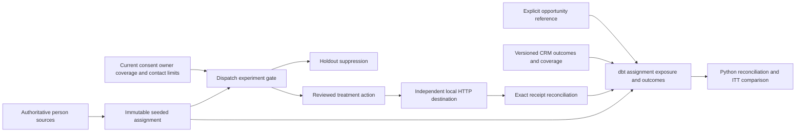

# Lifecycle experiments and outcomes

Controlled assignment answers a different question from delivery monitoring: does the assigned treatment population convert differently from the holdout? This extension enforces holdout at the existing lifecycle dispatch boundary and measures outcomes without filtering away people who could not receive treatment.

## Run and inspect

Use the repository's Python 3.12 environment and locked dependencies. Start a fresh local workspace so no prior contact can enter the experiment:

```text
python scripts/lifecycle.py --workspace .local/experiment-review --port 8572
```

Open http://127.0.0.1:8572, enter the launcher's temporary token, choose **Experiment & Outcomes**, then **Assign reference study** before delivering any action. Treatment people `synthetic-0007` and `synthetic-0009` are eligible in this fixture. Return to Lifecycle operations to approve exact content, lose an acknowledgment and reconcile. Holdouts cannot create an effect, including through onboarding. Load the finite arm-neutral synthetic outcome source, then apply its late correction. Read-only study inspection needs no token; mutations retain token and same-origin checks. The API is loopback-only, not a public deployment.

```text
python -m pytest tests/test_lifecycle_experiment.py -q
python scripts/verify_lifecycle_experiment.py work/new-study work/new-study-evidence
python scripts/check_lifecycle_experiment.py
```

The verifier requires a fresh working directory. It executes the actual HTTP destination, kills a worker after acceptance (exit 86), restarts and independently compares exact destination keys and payload hashes. It runs real dbt builds, a corrected incremental build and independent full refresh. The larger 1,200-person fixture exercises assignment, source revisions, measurement and dbt; only the reference fixture makes HTTP effects. It is not a throughput benchmark. Browser verification uses a separate fresh 12-person fixture through the real operator API; its screenshot shows one accepted person, while the core acceptance run verifies two independent effects.

## Assignment and safety

An immutable versioned specification binds journey, seed, allocation method and outcome window. A seeded SHA-256 threshold gives each brand/person an expected 50/50 allocation without forcing balance. Assignments retain person, brand, enrollment, epoch, timestamp, arm, original eligibility and source fingerprint. Retries cannot rerandomize them. A conflicting experiment or policy epoch is refused rather than silently enrolled again.

The exclusion unit covers every marketing journey for a brand/person. Holdouts suppress all of them; treatment can execute only the assigned enrollment/epoch and only before the outcome window closes. The finite implementation has one permanent study assignment per brand/person and no automatic washout/release mechanism. Already reserved contacts cannot join. Batch enrollment is one transaction, including rollback if a later person conflicts. People ineligible at assignment still belong to the assigned denominator.

Current consent, owner, opportunity, commercial state, coverage, quiet hours, exact approval and shared contact limits remain the dispatch authority. Experiment assignment never grants permission. Unknown outcomes retain their reservation and are not reported as delivery failures. Receipt reconciliation runs before new-action authorization, preserving an earlier effect after revocation without authorizing another POST. Cross-journey receipt contamination or a missing verified receipt withholds the rate comparison.

## Metric and source contracts

The [versioned metric contract](lifecycle-experiment-contract-v1.json) defines denominators, windows, allocation, revisions and uncertainty. The primary intention-to-treat comparison keeps all assigned people. It is unavailable until every window is mature and independently covered, both arms are nonempty and exposure integrity checks pass. The received subgroup is descriptive selection, not a causal comparison.

CRM conversion sources are positive/negative versioned outcomes at brand/person grain. A separate qualified activation milestone is not present in the current source contract; generic product activity is not relabeled as activation. Seven-day windows include assignment time and exclude the exact end. Source observation time governs visibility; the highest visible revision is selected before testing outcome type or effective time. A late correction can remove an outcome or move it outside the window. Full-window coverage cannot assert future observation. A receipt first reconciled after the reporting cutoff cannot change an earlier comparison: exposure and integrity checks both use visible history, not the action’s current mutable state. The late-receipt regression verifies exact historical report equality after real HTTP recovery.

Explicit opportunity value joins only on brand/person and exact CRM conversion reference. An unmatched relationship is an exception. Multiple opportunity sources contribute once each after revision selection, without conversion/receipt fanout. USD pipeline, invoiced amount, cash, recognized revenue and incremental commercial value are different measures. This study implements pipeline linkage; it has no invoice/cash/revenue attribution bridge and reports incremental commercial revenue as null. Existing account-level cash evidence remains separate.

The simulation selects every third person by ordinal for a day-one conversion, observed at day seven. The first person's source is corrected to false one second later. Assignment, eligibility and acceptance do not influence that rule. One explicit synthetic USD 125,000 opportunity and one unmapped USD 9,000 opportunity exercise inclusion/exclusion; correction removes the valid conversion link. Any arm difference is a synthetic fixture result, not business uplift. The approximate conservative interval uses Bonferroni-adjusted Wilson bounds; the small reference study cannot establish commercial significance.

## Model grains and reconciliation

| Model | Grain and keys |
|---|---|
| `fct_experiment_assignment` | One immutable assignment id; brand/person, study, enrollment, epoch, eligibility snapshot |
| `fct_experiment_exposure` | One assignment id; approval, verified receipt and unresolved attempt flags |
| `fct_experiment_outcome` | One assignment id; mature/covered flags, person conversion, exact-linked pipeline cents |
| `mart_experiment_comparison` | Study/arm; conserved assigned denominator and operational/outcome counts |

Warehouse export reads a consistent SQLite snapshot and commits the DuckDB raw tables together; this avoids partial source refreshes and per-row autocommit overhead. Execution should be quiescent while this bounded offline analytical build runs. The original five lifecycle models remain. The outcome model uses dbt delete+insert by assignment id and deliberately reevaluates every assignment, because clock maturity, late coverage and source corrections can affect old cohorts. This is correction-safe incremental materialization, not a selective large-warehouse performance claim. Python traverses revision winners, exact receipts, source links and populations independently of SQL and compares all arm aggregates. dbt tests enforce grain, denominator conservation and no holdout receipt. Incremental/full equality checks all nine complete model rowsets.



[Executed evidence and genuine screenshots](evidence/lifecycle-experiment/historical-receipt-fix/README.md). All earlier native Salesforce, Snowflake and Qwen records retain their original provenance; this extension executes no vendor integration or customer communications.
