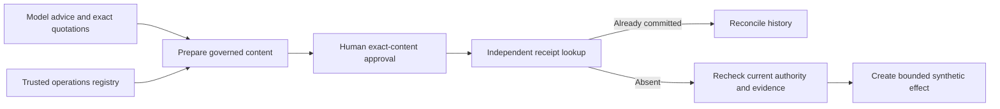

# Seller execution authority

The workbench separates model advice from executable CRM content. A valid quotation does not authorize an uncited availability, staffing, escalation, pricing or timing promise.

## Observed defect and correction

An unchanged archived support draft passed its original mechanical rubric. Replaying it through the previous workbench at `9c9f614` actually approved and delivered that wording to an isolated local HTTP task receiver. This was a synthetic task, not a customer communication or Salesforce execution. [Before/after records and actual UI captures](evidence/seller-authority/README.md) retain the source trace hash and the observed receipts.

The new `seller-execution/v1` contract governs **all delivered proposal fields**, not just the response textarea. Model assessment, draft, questions and uncertainties remain inspectable advisory material. They are not copied unchecked into the executable payload. Source quotations remain attached as explicitly untrusted evidence; matching a quote does not promote its contents into operational authority.

1. **Prepare governed review** constructs neutral internal-review wording for the selected action. The action must also be allowed for the verified account stage.
2. A reviewer may select independently registered operations records to add exact commitment statements. The registry binds issuer role, brand, account, owner, action, capability, revision and validity interval. It rejects ambiguous active records, identity reuse and revoked/expired records.
3. The reviewer inspects the prepared content and approves its exact proposal and source-run hash. Changes to any delivered field require another valid preparation; arbitrary free-form edits are refused.
4. Dispatch verifies the payload digest, original run binding and append-only approval proof. An independent exact receipt is sought first. Only an absent receipt can lead to a new write, after current evidence, consent, rejection status and operational authority are checked again.



Historical receipt reconciliation never authorizes another effect. Legacy approvals can still reconcile already committed effects, but cannot produce new writes under the new contract. Old approved payloads are not silently rewritten. The generation cache includes the execution-policy version so an older policy's run is not silently reused for new generation.

## Trust and usefulness limits

This is a finite execution-content contract, **not a general hallucination detector or semantic-entailment system**. Even benign unstructured prose remains advisory until converted into governed content. The model still interprets context, selects a proposed action and relevant exact source excerpts; the execution boundary deliberately permits a smaller language than the advisory workspace. The selected neutral wording is not represented as fresh model output.

An operational assertion's truth depends on its trusted issuer. The local demonstration's issuer allowlist is not enterprise identity authentication. The local host/database administrator is trusted; the authenticated reviewer HTTP API has no grant/revoke endpoint, and ordinary document admission cannot create operations records. A production deployment would need a separately authenticated operations source and identity administration. The destination adapter checks exact content/readback and permissions; it does not independently authenticate the upstream operations issuer. No Salesforce server-side semantic enforcement is claimed.

The scenario clock remains March 31, 2026. Grant validity and proposal expiry use that explicit clock in the demo; expiry tests advance it. These synthetic assertions do not establish present-day staffing or availability.

## Reproduce without credentials

Install the locked environment and Chromium using the repository setup, then choose a fresh workspace:

```shell
python scripts/verify_seller_authority.py --workspace work/authority-review-1 --output work/authority-review-1.json
python scripts/capture_seller_authority.py --workspace work/authority-ui-1 --output work/authority-ui-1
python -m pytest -q
```

The first command replays the unchanged archived response, verifies refusal, prepares and approves the governed response, then verifies actual local HTTP delivery and duplicate recovery. It performs no fresh inference or vendor calls. CI runs this lane explicitly. The browser capture uses the same archived response, a fresh isolated database and real Chromium controls; it does not edit screenshots manually.

For a running `scripts/seller.py --workspace work/seller-demo` instance, the trusted local administrator can register or revoke a synthetic assertion:

```shell
python scripts/seller_authority.py --workspace work/seller-demo --issuer support_operations --grant docs/examples/synthetic-seller-authority.json
python scripts/seller_authority.py --workspace work/seller-demo --issuer support_operations --revoke synthetic-slot-20260331
```

Refresh the workbench, select the applicable assertion, and prepare the review again. Registration alone does not approve or deliver a task. Two active assertions for one scoped capability require an explicit revocation, even if only one was selected. The [example](examples/synthetic-seller-authority.json) is synthetic test data, not a reservation or service commitment.

Optional actual inference uses the existing [pinned model setup](seller-workbench.md), an authenticated loopback endpoint and a private key file:

```shell
python scripts/verify_seller_authority.py --workspace work/authority-live-1 --output work/authority-live-1.json --model-url http://127.0.0.1:8093/v1 --model-key-file PRIVATE_LOCAL_KEY_FILE
```

Do not publish the key file or raw runtime logs. The runner excludes the key from reports. It retains failed generations and distinguishes actual model responses, archived replay, controlled rendering and local delivery. The original 120/120 mechanical benchmark and native Salesforce/Snowflake evidence are unchanged. Independent blinded usefulness assessment, general semantic support, and native execution of this new contract remain unverified.

Historical native executable hashes are verified at an explicit immutable Git revision, separately from today's implementation. The [evidence boundary](evidence/seller-authority/README.md) explains why default current-tree native fingerprint validation correctly fails after an executable change.
